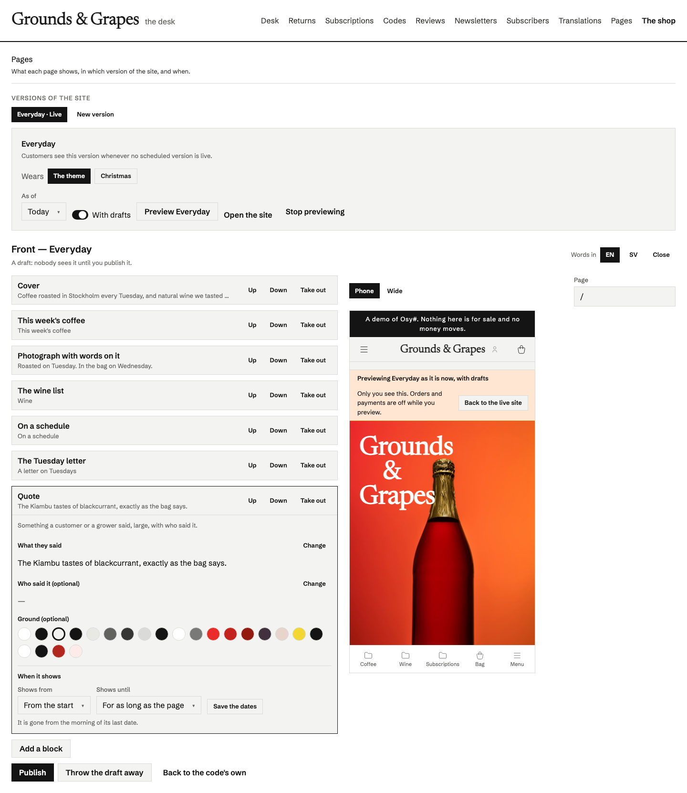
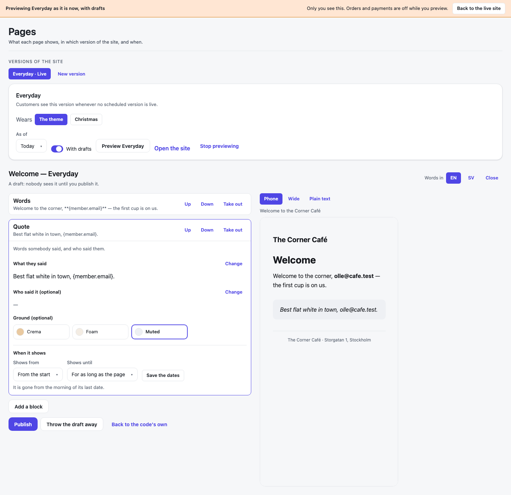
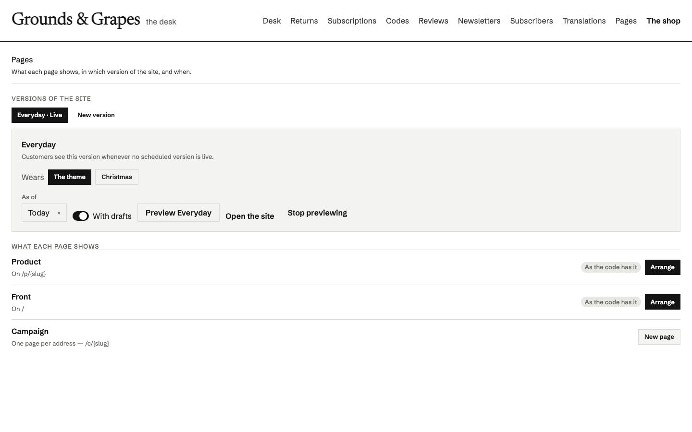

# Osysharp.PageBuilder

The desk where the people who run a site arrange its pages. The app's code declares **blocks** (`[Block] component …`)
and **regions** (`Region("front", allow: [...]) { … }`) with `Osysharp.Blocks`; this kit is where staff add, move, fill in
and take out blocks in those regions — beside the live page at phone and desk width — keep their changes as a draft, and
publish. No deploy, and nothing a customer sees changes until they press Publish.



- **Every region the code declares**, with the page it is on and whether it is still as the code has it, arranged, or
  has a draft waiting. A region with a key (`Region("campaign", key: slug, …)`) is one page per address: **New page**
  makes `/c/christmas-gifts` by naming it.
- **"Add a block" shows each block drawn small** in the site's own look, with its name and what it is for.
- **Mails too** — a mail's region (the words an order confirmation greets with, a photograph beside them) is arranged
  here, in the same versions, with the MAIL itself beside its blocks: at a phone's width, in a wide reading pane, and as
  its plain text, as the mail renderer writes it for a real order. A block the mail must keep **Stays**.

  
- **Fields chosen by the block's parameter types** — words, Markdown (in the Markdown editor), numbers in
  their range, a switch, a choice, the theme's own colours by name — only its grounds for a block's background — the
  app's pictures or an upload, a page of the app or a web address, a row to pick.
  Words are written per language: switch the desk to Swedish and a Swedish reader gets Swedish words.
- **The site's frame** — the menu (`SiteMenu(…)` in the layout) edited as a LIST: words, where it goes, hide, move in
  under the entry above, reorder, dates, per language; an outside address marked, a `javascript:` one refused. The
  strip across the top and the footer are regions in the layout, listed under *Around every page* (`ui-site-frame`).
- **Looks** — in an app that installs several (`ui-looks`), each version wears one: **Look** on its card, and before a
  switch, **What will not come along** — each block the new look has no design for — with *Switch* and *Keep*. The
  regions and the "Add a block" list are the version's look's, each block drawn small in that look.
- **Dated blocks** — a banner from the 1st to the 21st, gone from the morning of its last date.
- **Versions of the site** — Everyday, and copies of it (Christmas) with their own arrangements, live on a schedule
  (two cannot overlap) or now, each wearing a variant of the theme the code declares (`Modes.Of(light: …, christmas: …)`).
- **A preview of the whole site** as a version will look on a date, with or without drafts, for this staff member in
  this browser only — with a banner, and orders refused while it lasts (`SitePreviewing()`).
- **Flags what the code changed**: a block whose parameters changed is *Changed in code*; one removed is *No longer in
  the app*, and is not shown to customers.



## Use it

```osy
// app.osy
use Osysharp.Blocks;
use Osysharp.PageBuilder@1;
```

```osy
// the desk, on a page only staff reach
[Route("/staff/pages")]
[Authorize(IsStaff)]
component StaffPages() { render { PagesDesk(); } }

// the layout every public page uses: the live version's look, and the preview banner
[Layout]
component Site() { render { Stack(gap: 0) { SiteLook(); Outlet; } } }

// who may arrange — Osysharp.Blocks' one question, answered with the app's own roles
policy ArrangesPages => IsStaff;
```

Customers read only what is live — the tables' own rule — so a draft, a version scheduled for later and a block past its
dates are never shown to them, whatever reads the tables.

## Source

- `model/ui/Desk.osy` — the desk: `PagesDesk`, the region editor, the preview, the field editors.
- `model/ui/Menu.osy` — the menu's list editor (`PagesMenuEditor`).
- `model/ui/SiteLook.osy` — `SiteLook()`: the live version's theme variant, and the preview banner.
- `model/Pictures.osy` — uploads for a picture field.
- `model/Words.osy` — the Markdown editor's scratch copy of a field's words while they are written.
- `locales/sv.osy` — Swedish.
- `tests/` — a café whose front page and campaign pages staff arrange: the functions (`pages.test.osy`) and the desk on
  screen (`pages-ui.test.osy`, `osy test --pixels`).

The shop's blocks (a hero, a product row, the shelves, a picture with words, a quote, the newsletter, a banner) are in
[Osysharp.Shop](https://osyrin.com/templates/kits/shop/) (`model/ui/Blocks.osy`); the Grounds & Grapes demo store arranges its front page,
its product pages and its campaign pages with them. How blocks are declared is `osy docs ui-blocks`.

## Examples

Taken from this package's own tests, which compile and run on every release.

```osy
using Osysharp.Blocks;
using Osysharp.PageBuilder;

[Test(Cafe)]
void a_region_is_edited_as_a_draft_and_published() {
  runas (Anna) {
    var draft = EditRegion(MainVersion().Id, "front", "");
    var note = AddBlock(draft, "ShelfNote", 0);
    Assert.Equal("", SaveBlockValue(note, "en", new BlockValue { Name = "note", Text = "Fresh today" }));
    Assert.Equal("", SaveBlockValue(note, "en", new BlockValue { Name = "shelf", Ref = Shelf.Single(s => s.Name == "Cakes").Id }));
    Assert.Equal("", PublishRegion(draft));
  }
  var front = ArrangedRegion("front", "");
  Assert.True(front.Arranged);
  Assert.Equal(3, front.Blocks.Count);
  Assert.Equal("ShelfNote", front.Blocks[0].Block);
  Assert.Equal("Fresh today", front.Blocks[0].Values.Single(v => v.Name == "note").Text);
}
```

From [`tests/pages.test.osy`](tests/pages.test.osy).

```osy
using Osysharp.Blocks;
using Osysharp.PageBuilder;

[Test(Cafe)]
void a_value_that_is_not_its_parameters_kind_is_refused_by_name() {
  runas (Anna) {
    var draft = EditRegion(MainVersion().Id, "front", "");
    var hero = AddBlock(draft, "Headline", 0);
    Assert.Equal("Headline needs filling in.", SaveBlockValue(hero, "en", new BlockValue { Name = "title", Text = " " }));
    Assert.Equal("Ground: choose one of the theme's colours.", SaveBlockValue(hero, "en", new BlockValue { Name = "ground", Text = "#ff00ff" }));
    Assert.Equal("Weight: choose one of Light, Bold.", SaveBlockValue(hero, "en", new BlockValue { Name = "weight", Text = "Heavy" }));
    Assert.Equal("Photo: choose a picture the shop has, or upload one.",
      SaveBlockValue(hero, "en", new BlockValue { Name = "photo", Text = "https://elsewhere.example/cat.jpg" }));
    Assert.Equal("Link: the shop has no page at /nowhere.", SaveBlockValue(hero, "en", new BlockValue { Name = "link", Text = "/nowhere" }));
    Assert.Equal("", SaveBlockValue(hero, "en", new BlockValue { Name = "link", Text = "/c/christmas-gifts" }));
    Assert.Equal("Link: a page of the shop starts with /, an outside address with https://.",
      SaveBlockValue(hero, "en", new BlockValue { Name = "link", Text = "javascript:alert(1)" }));
    Assert.Equal("", SaveBlockValue(hero, "en", new BlockValue { Name = "title", Text = "Christmas at the corner" }));
    Assert.Equal("", SaveBlockValue(hero, "en", new BlockValue { Name = "ground", Text = "Berry" }));
  }
}
```

From [`tests/pages.test.osy`](tests/pages.test.osy).

```osy
using Osysharp.Blocks;
using Osysharp.PageBuilder;

[Test(Cafe)]
void schedules_may_not_overlap_and_the_scheduled_version_is_what_customers_see() {
  runas (Anna) {
    var main = MainVersion();
    var christmas = DuplicateVersion(main.Id, "Christmas");
    var draft = EditRegion(christmas, "front", "");
    var hero = AddBlock(draft, "Headline", 0);
    SaveBlockValue(hero, "en", new BlockValue { Name = "title", Text = "Merry from the corner" });
    Assert.Equal("", PublishRegion(draft));
    Assert.Equal("", ScheduleVersion(christmas, DateTime.UtcNow.AddDays(-1), DateTime.UtcNow.AddDays(20)));
    var summer = DuplicateVersion(main.Id, "Summer");
    Assert.Contains("overlaps Christmas", ScheduleVersion(summer, DateTime.UtcNow.AddDays(10), DateTime.UtcNow.AddDays(40)));
    Assert.Equal("", ScheduleVersion(summer, DateTime.UtcNow.AddDays(20), DateTime.UtcNow.AddDays(40)));
    Assert.Contains("the main version", ScheduleVersion(main.Id, DateTime.UtcNow, null));
  }
  Assert.Equal("Merry from the corner", ArrangedRegion("front", "").Blocks[0].Values.Single(v => v.Name == "title").Text);
}
```

From [`tests/pages.test.osy`](tests/pages.test.osy).

## Learn more

- [The Osysharp.PageBuilder reference](https://osysharp.com/reference/ui/pages-kit/)
- [Osysharp.PageBuilder in the package catalogue](https://osysharp.com/packages/#osysharp-pagebuilder)
- [The Osy# reference](https://osysharp.com/reference/) — the language, the runtime and every kit
- [`llms-full.txt`](https://osysharp.com/llms-full.txt) — the whole reference and specification as one Markdown file, for a coding agent

## Licence

MIT — see [`LICENSE`](LICENSE).
